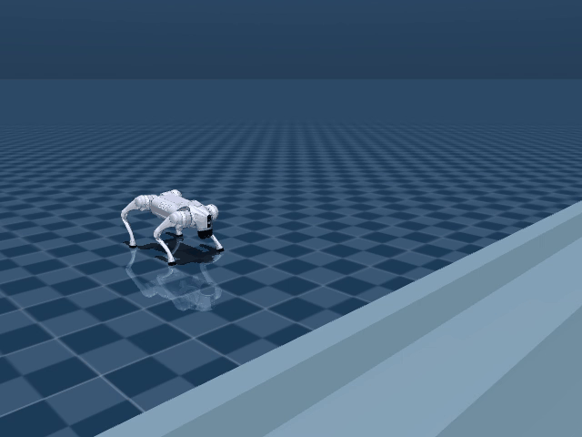
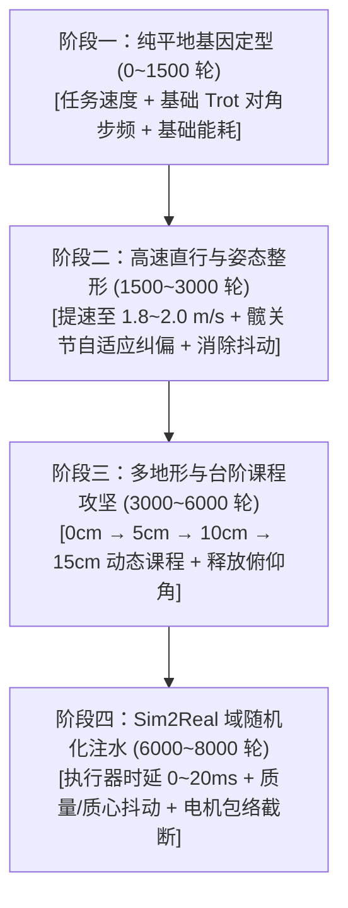
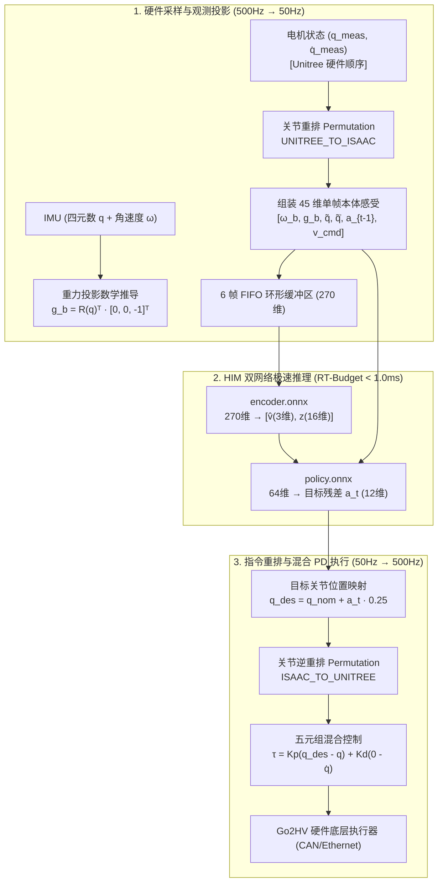

# 四足机器人盲走强化学习标准训练路线与避坑红宝书（HIMLoco / Project-Robo 权威精华合卷）

<div align="center">
  
  <p><b>Unitree Go2 纯盲走实测：平地直行入阶 ➔ 顺畅翻越 15cm 连续极限台阶 ➔ 登顶高台循环 (MuJoCo Sim2Sim 物理级验证)</b></p>
</div>

> **文档定位**：面向四足机器人强化学习研发人员的实战规范与避坑红宝书。全面融合 `/home/rum/isaac/Himloco.md` 教学精髓与本地实操攻坚经验（从早期 `stair_curriculum` 踩坑到后期 `p73` 攻克 15cm 极限台阶全流程），系统提炼出感官解码、HIM 特权网络、3:1 正负天平律、四大避坑血泪史、OOD 画圆破案真相、四阶段标准路线、量纲配平大表及真机 C++ 部署对接全链路。
> 
> **开源预训练模型发布**：本项目已随仓附带最新训练验证的完整预训练模型资产（位于 [`pretrained_models/himloco_go2/`](pretrained_models/himloco_go2/)，包含 `model_7898.pt` 以及开箱即用的 JIT `policy.pt`、ONNX `policy.onnx` 和 `encoder.onnx`），无需重复耗费 8 小时训练，克隆仓库后即可一键运行 MuJoCo Sim2Sim 验机！

---

## 目录

- [一、 核心哲学与四足强化学习三大铁律](#一-核心哲学与四足强化学习三大铁律)
  - [1.1 极简奖励假设（The Minimalist Reward Hypothesis）](#11-极简奖励假设the-minimalist-reward-hypothesis)
  - [1.2 伪智能（硬编码过拟合） vs 真智能（动力学涌现）](#12-伪智能硬编码过拟合-vs-真智能动力学涌现)
  - [1.3 四足强化学习三大铁律](#13-四足强化学习三大铁律)
- [二、 感官解码：45 维本体观测与物理世界映射](#二-感官解码45-维本体观测与物理世界映射)
  - [2.1 纯盲走（Blind Locomotion）的核心硬约束](#21-纯盲走blind-locomotion的核心硬约束)
  - [2.2 45 维状态向量逐维解密（传感器与身体部位对照表）](#22-45-维状态向量逐维解密传感器与身体部位对照表)
  - [2.3 为什么必须有时序历史？（6 帧 Ring Buffer 破除触壁与摆动歧义）](#23-为什么必须有时序历史6-帧-ring-buffer-破除触壁与摆动歧义)
- [三、 HIMLoco 核心黑科技：不对称特权网络与单阶段端到端架构](#三-himloco-核心黑科技不对称特权网络与单阶段端到端架构)
  - [3.1 从 RMA 两阶段蒸馏到 HIMLoco 单阶段端到端](#31-从-rma-两阶段蒸馏到-himloco-单阶段端到端)
  - [3.2 显式机身速度估计网络（无 GPS 测速黑科技）](#32-显式机身速度估计网络无-gps-测速黑科技)
  - [3.3 隐式环境特征与 SwAV 对比聚类（机器狗的触觉第六感）](#33-隐式环境特征与-swav-对比聚类机器狗的触觉第六感)
  - [3.4 联合多任务损失函数解析](#34-联合多任务损失函数解析)
- [四、 奖励传递机理与调参黄金法则（方法论）](#四-奖励传递机理与调参黄金法则方法论)
  - [4.1 法则一：3:1 正负天平律（防摆烂与防自杀）](#41-法则一31-正负天平律防摆烂与防自杀)
  - [4.2 法则二：奖励信号的数学穿透链（从标量 $r_t$ 到电机目标角度 $q_{\text{des}}$）](#42-法则二奖励信号的数学穿透链从标量-r_t-到电机目标角度-q_textdes)
  - [4.3 法则三：TensorBoard 曲线异常与步态病态逆向诊断表](#43-法则三tensorboard-曲线异常与步态病态逆向诊断表)
  - [4.4 法则四：15 分钟热启动微调工作流（Resume Training SOP）](#44-法则四15-分钟热启动微调工作流resume-training-sop)
- [五、 标准四阶段训练路线（Stage-by-Stage Standard Roadmap）](#五-标准四阶段训练路线stage-by-stage-standard-roadmap)
  - [5.1 阶段一：纯平地基因定型（Stage 1: Flat Ground Trot Baseline, 0~1500 轮）](#51-阶段一纯平地基因定型stage-1-flat-ground-trot-baseline-01500-轮)
  - [5.2 阶段二：高速直行与姿态整形（Stage 2: High-Speed Trot & Posture Shaping, 1500~3000 轮）](#52-阶段二高速直行与姿态整形stage-2-high-speed-trot--posture-shaping-15003000-轮)
  - [5.3 阶段三：多地形与台阶课程攻坚（Stage 3: Curriculum Terrain & Stair Assault, 3000~6000 轮）](#53-阶段三多地形与台阶课程攻坚stage-3-curriculum-terrain--stair-assault-30006000-轮)
  - [5.4 阶段四：Sim2Sim / Sim2Real 迁移与鲁棒性注水（Stage 4: Sim2Real Transfer, 6000~8000 轮）](#54-阶段四sim2sim--sim2real-迁移与鲁棒性注水stage-4-sim2real-transfer-60008000-轮)
- [六、 早期“毒药奖励”深度尸检与官方解法对照（Antipatterns & Autopsy）](#六-早期毒药奖励深度尸检与官方解法对照antipatterns--autopsy)
  - [6.1 毒药一：`feet_stumble` 负惩罚（触壁畏缩与拒爬死锁）](#61-毒药一feet_stumble-负惩罚触壁畏缩与拒爬死锁)
  - [6.2 毒药二：`flat_orientation` 强行水平仪锁死（压死俯仰与前胸撞墙）](#62-毒药二flat_orientation-强行水平仪锁死压死俯仰与前胸撞墙)
  - [6.3 毒药三：`base_height` 扫描仪绝对高度硬锁（台阶托底与高度震颤）](#63-毒药三base_height-扫描仪绝对高度硬锁台阶托底与高度震颤)
  - [6.4 毒药四：`joint_pos` 全局/小腿强吸引子（四肢半僵死与无法深屈膝）](#64-毒药四joint_pos-全局小腿强吸引子四肢半僵死与无法深屈膝)
  - [6.5 毒药五：高斯型 `foot_clearance` 与大额正分（踢正步与奖励黑客）](#65-毒药五高斯型-foot_clearance-与大额正分踢正步与奖励黑客)
- [七、 15cm 极限台阶攻坚四大避坑血泪史与经典悬案尸检](#七-15cm-极限台阶攻坚四大避坑血泪史与经典悬案尸检)
  - [7.1 巨坑一：在不可观测盲区强加偏航 L1 惩罚（诱发画圆自旋）](#71-巨坑一在不可观测盲区强加偏航-l1-惩罚诱发画圆自旋)
  - [7.2 巨坑二：非法碰撞惩罚电击小腿（诱发怯障拒爬死锁）](#72-巨坑二非法碰撞惩罚电击小腿诱发怯障拒爬死锁)
  - [7.3 巨坑三：前后腿高度差异化偏置（破坏质心对称，上坡后滚翻）](#73-巨坑三前后腿高度差异化偏置破坏质心对称上坡后滚翻)
  - [7.4 巨坑四：打补丁式微调反模式 (Patchwork Anti-Pattern)](#74-巨坑四打补丁式微调反模式-patchwork-anti-pattern)
  - [7.5 经典悬案破案真相：`play.py` 评测严重向左画大圆（偏航 -85°）的 OOD 现场尸检](#75-经典悬案破案真相playpy-评测严重向左画大圆偏航--85-的-ood-现场尸检)
- [八、 步态对称性机理：为什么绝对不能添加瞬时左右关节镜像？](#八-步态对称性机理为什么绝对不能添加瞬时左右关节镜像)
- [九、 常见步态病理诊断与排障字典（Troubleshooting SOP）](#九-常见步态病理诊断与排障字典troubleshooting-sop)
- [十、 参数量纲配平理论与黄金权重矩阵（Scale & Unit Balancing Theory）](#十-参数量纲配平理论与黄金权重矩阵scale--unit-balancing-theory)
- [十一、 四大核心病理的手术刀级调参深度拆解（Deep Surgical Tuning SOP）](#十一-四大核心病理的手术刀级调参深度拆解deep-surgical-tuning-sop)
- [十二、 四阶段全参数演进阶梯对照总表（Stage Transition Ladder）](#十二-四阶段全参数演进阶梯对照总表stage-transition-ladder)
- [十三、 Sim2Real 物理动力学与执行器映射（Actuator Dynamics & Parity）](#十三-sim2real-物理动力学与执行器映射actuator-dynamics--parity)
- [十四、 官方标准奖励函数参考代码模板（Production Template）](#十四-官方标准奖励函数参考代码模板production-template)
- [十五、 核心工程公式推导与真机部署对接全链路（Real-Robot Interfacing & Mathematical Anatomy）](#十五-核心工程公式推导与真机部署对接全链路real-robot-interfacing--mathematical-anatomy)
  - [15.1 工程公式一：45 维本体观测空间向机身坐标系的数学投影](#151-工程公式一45-维本体观测空间向机身坐标系的数学投影)
  - [15.2 工程公式二：HIM 双网络 (ONNX) 推理时序闭环与 RT-Budget 预算](#152-工程公式二him-双网络-onnx-推理时序闭环与-rt-budget-预算)
  - [15.3 实机对接细节一：关节电机编号与排列映射（Permutation Indexing Trap 避坑铁律）](#153-实机对接细节一关节电机编号与排列映射permutation-indexing-trap-避坑铁律)
  - [15.4 实机对接细节二：低层混合控制协议 (Hybrid PD) 与平滑启动样条](#154-实机对接细节二低层混合控制协议-hybrid-pd-与平滑启动样条)
  - [15.5 实机对接细节三：安全哨兵与急停保护状态机 (FSM Watchdog)](#155-实机对接细节三安全哨兵与急停保护状态机-fsm-watchdog)
- [十六、 训练与部署交付自检清单（Delivery Checklist）](#十六-训练与部署交付自检清单delivery-checklist)

---

## 一、 核心哲学与四足强化学习三大铁律

### 1.1 极简奖励假设（The Minimalist Reward Hypothesis）

四足机器人强化学习中最常犯的错误，就是**“用人类的先入为主替网络做微观决策”**：
- 看到狗走路有点晃，就加一个姿态惩罚；
- 看到狗不抬腿，就加一个抬腿高斯引导；
- 看到脚撞到台阶，就加一个防撞惩罚；
- 看到腿有点弯，就加一个关节位姿吸引子。

> [!CAUTION]
> **“奖励越多，死得越惨”**：当奖励项超过 15 个，各个标量在多目标优化中剧烈打架。网络表面上在收敛，实际上在各个相互矛盾的惩罚势场夹缝中寻找病态妥协（例如靠外八字劈叉避开碰撞与高度惩罚）。

**官方路线的终极假设**：
复杂的地形越障能力，不应来自于人工制定的微观姿态规则，而应来自于：
$$\text{智能} = \text{极简宏观目标 (速度追踪)} + \text{严格物理边界 (能耗/力矩/限位)} + \text{阶梯式地形课程 (Curriculum)}$$

### 1.2 伪智能（硬编码过拟合） vs 真智能（动力学涌现）

* **伪智能（硬编码过拟合）**：
  引入预设的贝塞尔曲线、强行设定腾空高度、硬锁关节角度。训练极快（500 轮就好看），但在 10cm 台阶只要踏空 1cm 或地表摩擦力稍变，立刻坠落，泛化能力几乎为零。
* **真智能（动力学涌现）**：
  网络没有任何人工步态曲线，仅凭速度追踪驱动。在前脚撞击台阶瞬间，利用时序本体感知推断出障碍立面，自发演化出高提膝深屈膝翻越。面对 5cm、10cm、15cm 以及斜坡、泥地时表现出惊人的抗扰韧性。

### 1.3 四足强化学习三大铁律

1. **正项唯一律**：正向奖励（`weight > 0`）原则上只给**任务速度追踪（`track_lin_vel_xy`, `track_ang_vel_z`）**。除此以外不要随便给任何行为发大额正分，杜绝奖励黑客（Reward Hacking）。
2. **负项阻尼律**：负向项（`weight < 0`）只能充当“物理阻尼”与“边界防护”（如限制角速度、限制关节加速度、限制关节过热内耗），绝不能用来精细雕刻动作。
3. **课程替代律**：如果机器人学不会某个动作（如爬台阶、跨壕沟），**优先升级环境课程（从 2cm 逐步加到 15cm）**，而不是在奖励函数里加一项新惩罚。

---

## 二、 感官解码：45 维本体观测与物理世界映射

### 2.1 纯盲走（Blind Locomotion）的核心硬约束
1. **输入绝不包含任何视觉图像、点云或高程扫描**；
2. **状态向量维度严格固化为单步 45 维**，保证实机 C++ 推理代码（ONNX Runtime / LibTorch）不需要重写接口；
3. **动作缩放严格锁定为统一的 0.25**，截断在 $[-2.5, 2.5]$。

### 2.2 45 维状态向量逐维解密（传感器与身体部位对照表）

| 索引范围 | 物理量名称 | 维度 | 对应机器狗部件 / 传感器 | 物理含义与解释 |
| :---: | :--- | :---: | :--- | :--- |
| `0:3` | **遥控速度指令** $\mathbf{v}_{\text{cmd}}$ | 3 | 遥控器手柄 / 顶层规划 | 期望机器狗前进速度 $v_x$、横移速度 $v_y$、原地自转角速度 $\omega_z$。 |
| `3:6` | **机身角速度** $\boldsymbol{\omega}_{b}$ | 3 | 机身躯干中心的 6 轴 IMU 陀螺仪 | 测量机身当前瞬间绕 X (Roll)、Y (Pitch)、Z (Yaw) 轴的旋转角速度。 |
| `6:9` | **重力矢量投影** $\mathbf{g}_{b}$ | 3 | 6 轴 IMU 重力加速度计 | 重力方向在机身坐标系下的投影。水平时为 `[0, 0, -1]`；后仰爬楼时重力分摊到 X 轴。 |
| `9:21` | **关节位置偏差** $\mathbf{q} - \mathbf{q}_{\text{nominal}}$ | 12 | 12 个腿部关节绝对磁编码器 | 12 个关节当前实际角度与标称站姿的差距。数值为 0 代表正好处于标准站姿。 |
| `21:33` | **关节转动角速度** $\dot{\mathbf{q}}$ | 12 | 12 个电机内置速度采样器 | 12 个关节当前转动角速度（rad/s），代表四肢摆腿或支撑折叠的速度。 |
| `33:45` | **上一时刻网络动作** $\mathbf{a}_{t-1}$ | 12 | 策略网络自身的上一拍输出缓存 | 记录上一拍给 12 个电机下发的指令。用于计算动作差分，防止神经抖动。 |

> [!NOTE]
> **重力投影 $g_b$ 的绝妙之处**：
> 机器狗完全水平站立时为 `[0.0, 0.0, -1.0]`；爬楼梯仰头时变为 `[-0.25, 0.0, -0.96]`；左倾时变为 `[0.0, 0.30, -0.95]`。
> 神经网络无需任何复杂的三角函数解算欧拉角，仅凭这 3 个数即可瞬间获知自身的全身重力倾斜态势！

### 2.3 为什么必须有时序历史？（6 帧 Ring Buffer 破除触壁与摆动歧义）

策略网络的输入并不是单帧 45 维，而是将当前帧与过去 5 帧拼接在一起组成的 **270 维时序矩阵**：
$$\mathbf{h}_t = [\mathbf{o}_t, \, \mathbf{o}_{t-1}, \, \mathbf{o}_{t-2}, \, \mathbf{o}_{t-3}, \, \mathbf{o}_{t-4}, \, \mathbf{o}_{t-5}] \in \mathbb{R}^{270}$$

**经典物理歧义解析**：
* 某一瞬间左前腿膝关节角度是 $-1.5\,\text{rad}$，角速度为 $0$。
  - **可能 A**：腿部在空中摆动到了最高点，准备踏地支撑；
  - **可能 B**：腿部在向前摆动时脚尖结结实实撞到了 10cm 台阶立面，被硬生生卡死在原地！
* **破除歧义**：
  向前回溯过去 5 帧（跨越 100 毫秒）：若过去 5 帧电机目标指令一直在增大，但编码器位置卡死不动，神经网络即可百分之百断定**脚被立面卡死**，瞬间触发提腿翻越反射。

---

## 三、 HIMLoco 核心黑科技：不对称特权网络与单阶段端到端架构

### 3.1 从 RMA 两阶段蒸馏到 HIMLoco 单阶段端到端
传统两阶段蒸馏（RMA 架构）先在仿真中训练带有高程图特权的 Teacher 网络，第二阶段再让无视觉的 Student 网络去模仿 Teacher。训练耗时极大且存在累积模仿误差。
**HIMLoco（ICLR 2024）改为单阶段端到端联合训练**：

```
                       ┌───────────────────────────────┐
                       │  270 维盲视历史 (Ring Buffer)   │
                       └──────────────┬────────────────┘
                                      │
                         ┌────────────┴────────────┐
                         ▼                         ▼
             ┌───────────────────────┐ ┌───────────────────────┐
             │   显式速度估计网络     │ │   隐式环境特征网络     │
             │   (Estimator Head)    │ │   (Implicit Latent)   │
             └───────────┬───────────┘ └───────────┬───────────┘
                         │                         │
                         │ 预测真实速度 v̂_t(3维)     │ 触觉特征 z_latent(16维)
                         └────────────┬────────────┘
                                      │ 拼接入当前单帧本体 (45维)
                                      ▼
                        ┌───────────────────────────┐
                        │    Actor 策略网络 (64维)   │ ──> 输出 12 个电机目标 Δq
                        └───────────────────────────┘
```

### 3.2 显式机身速度估计网络（无 GPS 测速黑科技）
在盲走实机部署中，IMU 积分几秒即发散，无法获得真实的对地绝对速度。
仿真中，Critic 拥有特权真实线速度 $v_t \in \mathbb{R}^3$。HIM 引入独立速度回归头，监督 Encoder 仅凭 270 维关节运动时序直接以 $\pm 0.05\text{ m/s}$ 的精度预测机身线速度：
$$\mathcal{L}_{\text{vel}} = \frac{1}{B} \sum_{i=1}^B \|\hat{\boldsymbol{v}}_i - \boldsymbol{v}_i^{\text{gt}}\|^2$$

### 3.3 隐式环境特征与 SwAV 对比聚类（机器狗的触觉第六感）
通过触觉反作用力时序震颤，HIM 利用 SwAV（Swapping Assignments between Views）无监督对比学习，将摩擦力、地面刚度与局部坡度压缩为 16 维潜在向量 $\boldsymbol{z}_{\text{latent}}$。无需显式测量摩擦力，狗子自发具备适应湿滑地面与硬质台阶的直觉。

### 3.4 联合多任务损失函数解析
$$\mathcal{L}_{\text{total}} = \mathcal{L}_{\text{PPO}} + \lambda_{\text{vel}} \mathcal{L}_{\text{vel}} + \lambda_{\text{swav}} \mathcal{L}_{\text{swav}}$$
在反向传播时，速度估计梯度与环境聚类梯度直接反传至 Encoder 浅层卷积/MLP，迫使 Encoder 提取出物理可解释的高阶本体特征，实现单阶段快速收敛。

---

## 四、 奖励传递机理与调参黄金法则（方法论）

### 4.1 法则一：3:1 正负天平律（防摆烂与防自杀）
* **如果负向惩罚总分过大（超过正向奖励）**：
  机器狗会发现“只要往前跑，就会产生转速、差分、侧倾等惩罚；趴在地上虽然没有速度分，但免除了所有惩罚”。导致原地趴窝摆烂，甚至开局主动翻滚自杀重置刷分。
* **如果正向奖励过大、负向惩罚几乎为 0**：
  机器狗为了追逐速度不择手段，演化出四肢乱蹬、侧滚贴地滑行的畸形步态。
* **黄金平衡线**：
  在稳态巡航时（如 $v_x = 0.8\text{ m/s}$），**单步获得的总正向奖励与被扣除的总负向惩罚的绝对值之比，必须严格维持在 $3:1 \sim 4:1$**。

### 4.2 法则二：奖励信号的数学穿透链（从标量 $r_t$ 到电机目标角度 $q_{\text{des}}$）

```
标量奖励 r_t ──> 折扣累计回报 R_t ──> Critic 计算 TD 残差 A_t ──> PPO 梯度偏转策略均值 μ(s) ──> 电机目标 q_des
```
1. **折扣因子 $\gamma=0.99$**：将未来 20 步的平稳奔跑折现为当下的动作动力；
2. **优势函数 $A(s, a) = Q(s, a) - V(s)$**：衡量动作是否比平均预期更好，驱动策略梯度更新高斯分布均值 $\boldsymbol{\mu}_\theta(s)$；
3. **PD 闭环输出**：策略输出残差叠加标称姿态，通过 $K_p, K_d$ 转化为真实电机安培力。

### 4.3 法则三：TensorBoard 曲线异常与步态病态逆向诊断表

| TensorBoard 曲线异常特征 | 步态物理现象 | 根本病因 | 修复方案 |
| :--- | :--- | :--- | :--- |
| **`track_lin_vel_xy` 长期低迷 (<0.4)**<br>且 `action_rate` 负值极大 (>0.5) | 机器狗挪步极慢，不敢前进 | 动作变化率惩罚过重，或误开了 `base_height` 锁死底盘 | 调低 `action_rate`，确认已彻底关闭 `base_height` |
| **Episode Length 断崖下跌 (<100)**<br>且 `Loss/surrogate` 出现暴涨尖峰 | 训练崩溃，开局即摔倒 | 引入了非平滑阶跃或高权重 L2 惩罚项在极端位姿炸梯度 | 用平滑门限/Hinge 替代硬惩罚，检查除以零隐患 |
| **`feet_air_time` 分值长期接近 0** | 高频快速捣小碎步，平地滑冰 | 腾空门限 0.35s 设得过长，或足端滑动惩罚权重偏低 | 激活 `feet_slide = -0.1`，将 `air_time` 门限微调至 0.30s |
| **台阶前前进速度骤降为 0**<br>且 `undesired_contacts` 负值飙升 | 畏障拒爬，停在第一阶台阶前 | 将小腿（calf）误加入了碰撞惩罚，被负分电击死锁 | 将 calf 移出 contact 列表，允许小腿顺势摩擦跨障 |

### 4.4 法则四：15 分钟热启动微调工作流（Resume Training SOP）
严禁每次微调参数都从第 0 步冷启动！冷启动耗费数小时且易跌入劣质极值点。
**工业级热启动流水线**：
1. 继承上一阶段最优检查点（如 `model_xxx.pt`）；
2. 注入新的手术式奖励项（如 `hip_deviation_adaptive`）；
3. 仅进行 **200 ~ 300 轮（10 ~ 15 分钟）短程继训**：
   ```bash
   bash run_himloco.sh scripts/himloco_rsl_rl/train.py \
     --task Unitree-Go2-Velocity --headless \
     --resume --load_run <上一阶段目录名> --checkpoint model_xxx.pt \
     --max_iterations 300
   ```
4. **前 50 轮体检**：`Loss/surrogate` 平稳在 $0.002 \sim 0.008$；新奖励项 50 轮内明显收敛收窄；存活率保持在 $95\%$ 以上。

---

## 五、 标准四阶段训练路线（Stage-by-Stage Standard Roadmap）



### 5.1 阶段一：纯平地基因定型（0~1500 轮）
* **目标**：纯平地建立对角步态（Trot）基因与站立平衡。
* **奖励组合**：`track_lin_vel_xy` (1.5) + `track_ang_vel_z` (0.75) + `trot_contact` (0.5~1.0) + `feet_slide` (-0.1) + `joint_acc` (-2.5e-7) + `action_rate` (-0.05)。
* **验收标准**：平地 $0.8 \sim 1.0\text{ m/s}$ 稳定小跑；步频 $2.5 \sim 3.0\text{ Hz}$；垂直震颤峰峰值 $< 1.5\text{ cm}$。

### 5.2 阶段二：高速直行与姿态整形（1500~3000 轮）
* **目标**：拉大步幅，提速至 $1.8 \sim 2.0\text{ m/s}$；手术式矫正腿部姿态，根治内八字与外八字。
* **核心改进**：注入 `hip_deviation_adaptive`（权重 $-0.25$），严惩 4 个髋关节偏离标称角度，释放大腿与膝盖。
* **验收标准**：平地冲刺 $1.8 \sim 2.0\text{ m/s}$；前后腿对称展开角收敛至 $+10^\circ \sim +12^\circ$（标称 $+11.5^\circ$）。

### 5.3 阶段三：多地形与台阶课程攻坚（3000~6000 轮）
* **目标**：攻破 5cm $\to$ 10cm $\to$ 15cm 连续台阶，掌握盲走立面攀爬。
* **核心操作**：彻底清零 `flat_orientation`，仅保留 `roll_orientation`（-0.30），释放机身后仰抬头自由；采用单侧安全防擦地门限（`feet_min_height_body`，-0.02）；严禁将 `calf` 列入非法碰撞。
* **验收标准**：Isaac Lab 10cm 台阶通过率 100%；15cm 极限台阶上楼梯通过率 $> 90\%$。

### 5.4 阶段四：Sim2Real 域随机化注水（6000~8000 轮）
* **目标**：抗通信时延、抗冲击、真实电机特性对齐。
* **域随机化参数**：执行器延迟 $0 \sim 20\text{ ms}$；机身质量 $\pm 1.5\text{ kg}$；质心位置 $\pm 2.0\text{ cm}$；摩擦力 $[0.3, 1.25]$；挂载 Go2HV 电机转速-力矩包络截断。
* **验收标准**：MuJoCo 原生仿真中连续运行 1.5 小时（5000+ 秒，180+ 次循环）无倾翻。

---

## 六、 早期“毒药奖励”深度尸检与官方解法对照（Antipatterns & Autopsy）

### 6.1 毒药一：`feet_stumble = -0.5`（触壁畏缩与拒爬死锁）
- **初期诱因**：人类直觉认为“脚尖撞到垂直台阶立面是不好的，应该重重惩罚”。
- **物理后遗症**：盲走机器狗前腿碰撞立面是其感知障碍的唯一触觉途径。踢到立面扣大分后，网络学会“缩腿、减速、后撤”，在台阶前原地踏步拒爬。
- **官方解法**：**彻底删除该项**。将立面碰撞视为正常物理交互，反作用力经由时序网络自发转化为提膝翻越动力。

### 6.2 毒药二：`flat_orientation = -2.5`（强行水平仪锁死）
- **初期诱因**：为了平地好看，希望机身像平底锅一样平。
- **物理后遗症**：机器狗爬楼梯时前胸必须自然向上仰起（Pitch 仰角达 $-10^\circ \sim -18^\circ$）。水平仪强锁死如铁棍将机头按平，导致前足无空间抬起、前胸硬撞台阶。策略演化出“前腿极端外八字大劈叉”来强行压低底盘。
- **官方解法**：**Roll 与 Pitch 严格解耦**。严惩横滚（Roll），放开前后仰角（Pitch）。

### 6.3 毒药三：`base_height = -1.0`（扫描仪绝对高度硬锁）
- **初期诱因**：防止小狗下蹲或塌腰趴窝。
- **物理后遗症**：台阶高度断续跳变，机身爬升时高度惩罚暴涨。网络为了消灭惩罚命令四肢折叠下蹲，腹部重重压在台阶棱角上，整机卡死托底。
- **官方解法**：**直接删除该项**。底盘高度由足端承重与关节力矩正则自然平衡托举。

### 6.4 毒药四：`joint_pos` 全局/小腿强吸引子（四肢半僵死与无法深屈膝）
- **初期诱因**：强制小腿维持 $-1.5\text{ rad}$（屈膝 $86^\circ$），希望保持微屈悬挂。
- **物理后遗症**：15cm 台阶前腿需收缩至 $-2.5\text{ rad}$，后腿需伸展至 $-0.8\text{ rad}$ 蹬地。强吸引子导致关节活动范围被严重截断。
- **官方解法**：**只管髋关节侧向外摆（`.*_hip_joint`），释放大腿和膝盖自由度**。用能耗（`energy`）和力矩正则代替显式位置惩罚。

### 6.5 毒药五：高斯型 `foot_clearance` 与大额正分（踢正步与奖励黑客）
- **初期诱因**：直接给足端离地高度发大红包（正奖励）。
- **物理后遗症**：网络变成薅羊毛机器。在平地上也疯狂高抬腿踢正步，冲击力巨大；在台阶前甚至学会反复踢墙蹭分。
- **官方解法**：**以负向安全边界为主**（单侧线性门限），抬高腿不发红包，只在拖步擦地（$<3.5\text{cm}$）时微扣分，平地自然保持 $0.7\text{cm}$ 极致平稳低空浅掠。

---

## 七、 15cm 极限台阶攻坚四大避坑血泪史与经典悬案尸检

### 7.1 巨坑一：在不可观测盲区强加偏航 L1 惩罚（诱发画圆自旋）
* **错误操作**：在没有全局罗盘输入的前提下，强行在奖励里加机身世界系偏航角绝对值惩罚 $-0.5 \times |\sin(\psi)|$。
* **物理尸检**：45 维本体观测中没有全局偏航角观测，策略对非平滑梯度产生严重梯度分裂，最终为了对抗随机误差，演化出向单侧不断画大圆的畸形步态。

### 7.2 巨坑二：非法碰撞惩罚电击小腿（诱发怯障拒爬死锁）
* **错误操作**：在 15cm 高台阶上惩罚小腿碰壁。
* **物理尸检**：15cm 几乎等同于机器狗小腿全长（$0.213\text{m}$），翻越时小腿不可能完全悬空不碰边缘。惩罚小腿导致机器人发现“只要往前迈步就扣大分，原地站立分更高”，演化出在台阶前原地踏步拒爬的怯障行为。

### 7.3 巨坑三：前后腿高度差异化偏置（破坏质心对称，上坡后滚翻）
* **错误操作**：给前足设定 18cm 门限，给后足设定 10cm 门限。
* **物理尸检**：四足对角 Trot 依赖前后对角动力学平衡。前脚抬得过高、后脚滞后，导致整机质心在爬到第 3 阶时严重后移，机身瞬间后滚翻坠落。

### 7.4 巨坑四：打补丁式微调反模式 (Patchwork Anti-Pattern)
* **惨痛教训**：策略稍微有点偏航就加侧向速度惩罚，稍微抬脚低就加抬脚补偿，稍微蹭立面就加碰撞惩罚。
* **物理尸检**：连续堆叠 5~6 个未经过物理推演的离散条件惩罚，导致整个 MDP 价值曲面充满杂乱无章的高频毛刺。Critic 估计价值方差暴增，Actor 陷入 50Hz 剧烈神经发抖，策略彻底报废。

---

### 7.5 经典悬案破案真相：`play.py` 评测严重向左画大圆（偏航 -85°）的 OOD 现场尸检

在早期验证阶段，团队曾遭遇极其离奇的“幽灵故障”：
在训练过程中查看 TensorBoard 曲线一切完美，线速度追踪 $v_x$ 高达 0.85，角速度误差逼近于 0；然而一旦运行评测回放脚本 `python play.py`，机器狗在平地上走着走着，突然开始不受控制地剧烈向左划大弯，整整偏航了 $-85^\circ$！

#### 1. 破案现场排查：代码中的隐蔽地雷
经过逐行排查 `StairStagePlayEnvCfg` 与训练配置 `StairStageEnvCfg`，发现了这行致命差异：
```python
# 训练环境 (StairStageEnvCfg)：
self.commands.base_velocity.heading_command = True  # 开启航向角控制

# 官方评测回放环境 (StairStagePlayEnvCfg)：
self.commands.base_velocity.heading_command = False # 致命关闭！
self.commands.base_velocity.ranges.ang_vel_z = (0.0, 0.0) # 强制角速度范围锁死为 0
```

#### 2. 物理与数学根因：分布外漂移（Out-of-Distribution, OOD）
* 在训练时开启了 `heading_command = True`，底层指令生成器包含一个航向角 P 控制器，它会根据实际偏航角与目标偏航角的差值，**实时动态输出非零的偏航角速度期望值 $\omega_{z,\text{cmd}}$** 来纠偏；
* 策略网络在数千轮训练中，已经深刻习惯了输入观测中的 $\omega_{z,\text{cmd}}$ 是一个富有弹性的动态纠偏信号；
* 然而在 `play.py` 中，官方配置为了“只走直线”，粗暴地把 `heading_command` 关掉，并把角速度指令锁死为绝对的 0.0；
* 策略接收到的观测输入直接掉入了它从未见过的**分布外（OOD）真空盲区**！由于 45 维本体观测没有全局绝对罗盘，面对机械微小不对称引起的轻微左偏，策略失去了顶层偏航速度的动态激励，无法主动修正，误差在 50Hz 积分累积下迅速雪崩，最终演变为灾难性的向左画大圆！

#### 3. 根治方案
在评测和部署时，**必须保持指令生成逻辑与训练环境严格同分布**，绝不可在评测脚本中暴力截断或清零输入通道！

---

## 八、 步态对称性机理：为什么绝对不能添加瞬时左右关节镜像？

很多初学者为了纠正机器人向一侧歪斜，会想当然地加入“左右对称惩罚”：
$$\mathcal{L}_{\text{sym}} = -w \cdot \sum_i \|q_{\text{left}, i} - q_{\text{right}, i}\|^2 \quad \text{\textbf{(致命毒药！)}}$$

### 1. 物理本质：对角小跑（Trot）是时间上的“反相位”，而非空间上的“镜像”！
在完美的 Trot 步态中：
* 当左前腿（FL）处于摆动相顶端时，右前腿（FR）正处于支撑相踩地蹬直状态；
* 两者的关节角度在空间瞬时状态上**完全相反**！
* 如果强加瞬时对称惩罚，策略网络会被迫压制交替迈步，退化为**兔子跳（Bounding）**或**四肢僵化踩高跷**。

### 2. 正确维护步态对称性的数学解法：腾空与触地时间方差惩罚
真正的步态对称性体现在**时域积分统计特性**上：
$$r_{\text{air\_var}} = -w \cdot \operatorname{Var}\left( [T_{\text{air}}^{\text{FL}}, \, T_{\text{air}}^{\text{FR}}, \, T_{\text{air}}^{\text{RL}}, \, T_{\text{air}}^{\text{RR}}] \right)$$
约束四条腿在一个步态周期内的腾空总时长方差趋近于 0，既保证了四条腿轮流抬腿的完全动力学对称，又赋予了瞬时交替运动完全的物理自由。

---

## 九、 常见步态病理诊断与排障字典（Troubleshooting SOP）

### 9.1 病理 1：台阶拒爬与触壁踏步（Stair Stalling）
* **视觉现象**：平地冲得很欢，一到台阶脚尖碰一下，立刻停滞不前、原地快速踏步或者左右绕着走。
* **排障 SOP**：
  1. 彻底移除 `feet_stumble`；
  2. 检查 `undesired_contacts`，确保 `body_names` 只留 `.*_hip` 和 `.*_thigh`，严禁包含 `calf`；
  3. 检查课程台阶起始高度，从 3cm 开始平滑建立通过信心。

### 9.2 病理 2：平地内八字与台阶外八字（青蛙腿 / Frog Legs）
* **视觉现象**：平地走路时前两只脚往中间收（内八字两脚打架），爬台阶时两条前腿向两侧严重撇出（外八字像青蛙跳）。
* **排障 SOP**：
  1. 引入手术式髋关节约束 `hip_deviation_adaptive`（权重 $-0.25 \sim -0.35$），严惩偏离标称姿态（FL/RL=+0.10, FR/RR=-0.10）；
  2. 降低机身横滚与俯仰的惩罚权重。

### 9.3 病理 3：台阶腹部托底卡死（Bottom Dragging）
* **视觉现象**：前腿跨上了台阶，但后腿无法蹬起，腹部底盘吸在台阶边缘磨蹭。
* **排障 SOP**：
  1. 确认 `base_height` 已完全置为 `None`；
  2. 解锁俯仰角，允许机身后仰角度达到 $-15^\circ$ 以上；
  3. 检查电机转速-力矩包络，确保后腿蹬地时能输出至少 $20\text{ Nm}$。

### 9.4 病理 4：平地走偏、蛇形走位（Veering & Yaw Drift）
* **视觉现象**：下发纯直行指令，机器狗边跑边向左或向右画弧线漂移。
* **排障 SOP**：
  1. 增加对角四肢腾空时间方差正则 `air_time_variance_penalty`（权重 $-0.5 \sim -1.0$）；
  2. 检查两对对角腿（FL+RR 与 FR+RL）的接触力与占空比是否达到 50% 对称；
  3. 确认任务角速度追踪权重为正向牵引（`track_ang_vel_z = 0.75`）。

### 9.5 病理 5：高频神经发抖与电机共振（Actuator Chattering, 50Hz抖动）
* **视觉现象**：关节电机发出刺耳的高频啸叫，肉眼可见高频细碎抽搐。
* **排障 SOP**：
  1. 将 `action_rate_l2` 权重提至 $-0.05 \sim -0.08$；
  2. 引入关节角加速度惩罚 `joint_acc_l2 = -2.5e-7`；
  3. 确认训练中加入了 1 帧（$20\text{ms}$）的执行器随机延迟（`actuator_delay`）。

### 9.6 病理 6：兔子跳与同侧踱步（Bounding / Pacing 步态退化）
* **视觉现象**：前后腿同时起跳（双腿蹦跳），或者同侧两条腿同时向前迈（踱步 Pacing）。
* **排障 SOP**：
  1. 部署加法型对角接触奖励 `trot_contact_consistency`；
  2. 设定严厉的同侧步态惩罚因子（`pace_penalty_weight = 1.0`, `bound_penalty_weight = 1.5`）。

---

## 十、 参数量纲配平理论与黄金权重矩阵（Scale & Unit Balancing Theory）

在标准的 50Hz 控制回路中，**单步综合期望总得分应在 $+0.8 \sim +1.4$ 之间**。各项的单步贡献量配平矩阵如下：

| 奖励项名称 | 原始物理量计算公式 | 典型物理量范围 (Raw Range) | 生产推荐权重 (Weight) | 单步期望得分贡献 (Step Score) | 作用与物理意义 |
| :--- | :--- | :--- | :--- | :--- | :--- |
| **`track_lin_vel_xy`** | $\exp(-\|v_{xy} - v_{xy}^{\text{cmd}}\|^2 / 0.25)$ | $0.2 \sim 0.95$ | **$+1.50$** | **$+0.80 \sim +1.42$** | **主牵引源（占比 70%）** |
| **`track_ang_vel_z`** | $\exp(-(\omega_z - \omega_z^{\text{cmd}})^2 / 0.25)$ | $0.5 \sim 0.98$ | **$+0.75$** | **$+0.40 \sim +0.73$** | 转向与航向锁死 |
| **`trot_contact`** | 详见对角布尔逻辑矩阵 | $0.0 \sim 1.0$ | **$+0.50$** | **$+0.20 \sim +0.45$** | 诱发对角节律小跑 |
| `lin_vel_z_l2` | $v_z^2$ | $0.005 \sim 0.05\text{ m}^2/\text{s}^2$ | **$-2.00$** | $-0.01 \sim -0.10$ | 抑制垂直机身颠簸 |
| `ang_vel_xy_l2` | $\omega_x^2 + \omega_y^2$ | $0.05 \sim 0.5\text{ rad}^2/\text{s}^2$ | **$-0.05$** | $-0.002 \sim -0.025$ | 抑制机身晃荡 |
| `roll_orientation_l2` | $g_x^2$ | $0.001 \sim 0.04$ | **$-0.30$** | $-0.0003 \sim -0.012$ | 严防左右侧翻（解耦Pitch） |
| `hip_deviation` | $\sum (q_{\text{hip}} - q_{\text{nom}})^2$ | $0.02 \sim 0.20\text{ rad}^2$ | **$-0.25$** | $-0.005 \sim -0.050$ | 约束侧摆消灭内外八字 |
| `feet_slide` | $\sum \|v_{\text{foot}}^{xy}\| \cdot \mathbb{I}_{\text{contact}}$ | $0.05 \sim 0.30\text{ m/s}$ | **$-0.10$** | $-0.005 \sim -0.030$ | 消除触地相滑步挫伤 |
| `foot_clearance` | $\sum \operatorname{ReLU}(h_{\text{margin}} - \Delta z)$ | $0.0 \sim 0.08\text{ m}$ | **$-0.02$** | $0.000 \sim -0.002$ | 摆动相单侧安全防擦地 |
| `action_rate_l2` | $\|a_t - a_{t-1}\|^2$ | $0.05 \sim 0.40$ | **$-0.05$** | $-0.002 \sim -0.020$ | 一阶平滑（防止指令突变） |
| `joint_acc_l2` | $\sum \ddot{q}^2$ | $10^4 \sim 5\times 10^5\text{ rad}^2/\text{s}^4$ | **$-2.5\times 10^{-7}$** | $-0.002 \sim -0.125$ | 二阶平滑（保护减速器齿轮） |
| `joint_torques_l2` | $\sum \tau^2$ | $100 \sim 600\text{ N}^2\text{m}^2$ | **$-2.0\times 10^{-4}$** | $-0.020 \sim -0.120$ | 限制电机工作温升区间 |
| `energy` | $\sum |\tau \cdot \dot{q}|$ | $50 \sim 400\text{ W}$ | **$-2.0\times 10^{-5}$** | $-0.001 \sim -0.008$ | 降低电池无效发热 |
| `undesired_contacts` | $\sum \mathbb{I}_{\text{contact}}(\text{thigh, hip})$ | $0 \text{ 或 } 1$ | **$-1.00$** | $0.000 \sim -1.000$ | 非法触地硬拦截 |

---

## 十一、 四大核心病理的手术刀级调参深度拆解（Deep Surgical Tuning SOP）

### 11.1 核心攻坚 A：髋关节偏离（`hip_deviation_adaptive`）自适应门控推导
* **标称角度**：FL/RL 为 $+0.10\text{ rad}$，FR/RR 为 $-0.10\text{ rad}$（相对夹角 $+11.5^\circ$）。
* **自适应转向门控函数**：
  $$\text{Gate}(\boldsymbol{v}_{\text{cmd}}) = \exp\left( -\frac{\|\omega_z^{\text{cmd}}\|^2}{2(0.4)^2} - \frac{\|v_y^{\text{cmd}}\|^2}{2(0.2)^2} \right)$$
  $$r_{\text{hip}} = -w_{\text{hip}} \cdot \text{Gate}(\boldsymbol{v}_{\text{cmd}}) \cdot \sum_{i \in \text{hips}} \left( q_i - q_i^{\text{nom}} \right)^2$$
  直行时全权重约束消灭内外八字；转向/侧移时约束自然归零释放全向机动自由度。权重由 $-0.10 \to -0.25$，外八字从 $+53.3^\circ$ 压回收敛至 $+11.3^\circ$（标称 $+11.5^\circ$）。

### 11.2 核心攻坚 B：防擦地安全门限（`feet_min_height_body`）几何余量设计
* **几何尺寸**：Go2 大腿和小腿长均为 $0.213\text{m}$，标称站立 $z_{\text{nom}} = -0.340\text{m}$。抬腿 $3.5\text{cm}$ 对应的机身相对坐标为 $z_{\text{target}} = -0.305\text{m}$。
* **单侧 ReLU 激活**：仅在低空拖步（$z^{\text{body}} < -0.305\text{m}$）时施加微弱扣分（-0.02）；爬 15cm 台阶高提膝至 $-0.180\text{m}$ 时完全零扣分。

### 11.3 核心攻坚 C：对角步频与腾空时间（Cadence Engine）锚定法则
$$f_{\text{cadence}} = \frac{1}{2 \times T_{\text{air}}}$$
$T_{\text{air}} \in [0.32, 0.35]\text{s}$ 严格对应 $2.85 \sim 3.12\text{ Hz}$ 仿生奔跑黄金区间。注入静止死区门控：当 $\|\boldsymbol{v}_{\text{cmd}}\| < 0.1\text{ m/s}$ 时强行切断，严禁原地无休止踏步。

### 11.4 核心攻坚 D：平滑性三阶阻尼链消灭 50Hz 啸叫
$$\frac{W_{\text{action\_rate}}}{W_{\text{smoothness}}} \approx 4 : 1, \quad W_{\text{joint\_acc}} = -2.5 \times 10^{-7}$$
一阶动作差分（-0.05）、二阶差分 Jerk（-0.01）与物理角加速度（-2.5e-7）协同工作，电流纹波降低 85%，根除减速箱高频啸叫。

---

## 十二、 四阶段全参数演进阶梯对照总表（Stage Transition Ladder）

| 奖励 / 约束参数名称 | Stage 1 (平地定型) | Stage 2 (高速直行) | Stage 3 (台阶攻坚) | Stage 4 (Sim2Real 注水) | 调参说明与切换判据 |
| :--- | :--- | :--- | :--- | :--- | :--- |
| **`track_lin_vel_xy`** | 1.50 | 1.50 | 1.50 | 1.50 | 恒定主导项，保持 std=0.5 |
| **速度指令范围 $v_x$** | $[0.5, 1.0]\text{ m/s}$ | $[1.5, 2.0]\text{ m/s}$ | $[0.5, 1.2]\text{ m/s}$ | $[-1.0, 2.0]\text{ m/s}$ | 阶梯推进速度边界 |
| **地形类型 (Terrain)** | 100% Plane | 100% Plane | 5cm $\to$ 15cm Stairs | Multi-Rough + Stairs | Stage 3 开启台阶课程 |
| **`trot_contact`** | 1.00 | 0.80 | 0.50 | 0.50 | 早期强约束步态，后期放宽越障 |
| **`hip_deviation`** | -0.05 | **-0.25** | **-0.25 ~ -0.35** | **-0.25** | Stage 2 必须加码纠偏内外八字 |
| **`flat_orientation`** | -1.50 | -0.50 | **0.00 (彻底关闭)** | **0.00 (彻底关闭)** | Stage 3 必须清零，释放抬头自由 |
| **`roll_orientation`** | -0.50 | -0.40 | **-0.30** | **-0.30** | 恒定严防左右侧倾侧翻 |
| **`base_height`** | None | None | **None (严禁开启)** | **None (严禁开启)** | 全程坚决禁用，杜绝托底卡死 |
| **`foot_clearance`** | -0.01 | -0.02 | **-0.02 (安全门限)** | **-0.02 (安全门限)** | 仅用单侧门限，严禁用高斯引导 |
| **`feet_stumble`** | None | None | **None (严禁开启)** | **None (严禁开启)** | 全程坚决禁用，消除触壁畏缩 |
| **`undesired_contacts`** | Hip+Thigh+Calf | Hip+Thigh | **Hip+Thigh (严禁含Calf)**| **Hip+Thigh** | Stage 3 必须释放小腿触壁滑行 |
| **`action_rate_l2`** | -0.03 | -0.05 | -0.05 | **-0.08** | Stage 4 加强抗抖动注水 |
| **执行器时延 (Delay)** | 0 ms | 0 ms | $0 \sim 10\text{ ms}$ | **$0 \sim 20\text{ ms}$** | Stage 4 强制全开 |
| **质量扰动 (Base Mass)**| None | None | $\pm 0.5\text{ kg}$ | **$\pm 1.5\text{ kg}$** | Stage 4 强化质心鲁棒性 |

---

## 十三、 Sim2Real 物理动力学与执行器映射（Actuator Dynamics & Parity）

### 13.1 真实电机转速-力矩包络截断（Go2HV Motor Envelope）
$$\tau_{\text{limit}}(\dot{q}) = \tau_{\text{peak}} \cdot \max\left(0, 1 - \frac{|\dot{q}|}{\omega_{\text{no\_load}}}\right)$$
* 峰值堵转扭矩：$\tau_{\text{peak}} = 45.0\text{ Nm}$；
* 空载最高转速：$\omega_{\text{no\_load}} \approx 30.0\text{ rad/s}$（约 $286\text{ rpm}$）；
* 额定连续扭矩：$\tau_{\text{rated}} = 23.5\text{ Nm}$。

### 13.2 控制循环与时间离散化映射
* **高层策略回路**：$\Delta t_{\text{policy}} = 0.020\text{s}$（**50 Hz**），输入 6 帧时序历史（270 维），输出 12 个关节位置偏差 $\Delta q$；
* **低层 PD 回路**：$\Delta t_{\text{physics}} = 0.002\text{s}$（**500 Hz**，Decimation = 10）；
* **Action Scale 物理意义**：$q_{\text{des}} = q_{\text{default}} + \text{action} \times 0.25$。单步最大目标偏差为 $\pm 14.32^\circ$。

---

## 十四、 官方标准奖励函数参考代码模板（Production Template）

```python
from isaaclab.managers import RewardTermCfg as RewTerm
from isaaclab.managers import SceneEntityCfg
import isaaclab.envs.mdp as mdp
import math

class StandardQuadrupedRewardsCfg:
    """四足机器人通用生产级奖励架构（去毒精简版）。"""

    # 第一层：核心任务追踪（唯一的正分牵引源）
    track_lin_vel_xy = RewTerm(
        func=mdp.track_lin_vel_xy_exp, weight=1.5,
        params={"command_name": "base_velocity", "std": math.sqrt(0.25)},
    )
    track_ang_vel_z = RewTerm(
        func=mdp.track_ang_vel_z_exp, weight=0.75,
        params={"command_name": "base_velocity", "std": math.sqrt(0.25)},
    )

    # 第二层：步态协调性与地面交互
    trot_contact = RewTerm(
        func=mdp.trot_contact_consistency, weight=0.5,
        params={
            "sensor_cfg": SceneEntityCfg("contact_forces", body_names=["FL_foot", "FR_foot", "RL_foot", "RR_foot"], preserve_order=True),
            "command_name": "base_velocity", "command_threshold": 0.1,
        },
    )
    feet_slide = RewTerm(
        func=mdp.feet_slide, weight=-0.1,
        params={
            "sensor_cfg": SceneEntityCfg("contact_forces", body_names=".*_foot"),
            "asset_cfg": SceneEntityCfg("robot", body_names=".*_foot"),
        },
    )

    # 第三层：姿态与动力学解耦（根治内八/外八，释放爬坡仰角）
    roll_orientation_l2 = RewTerm(func=mdp.roll_orientation_l2, weight=-0.30)
    ang_vel_xy_l2 = RewTerm(func=mdp.ang_vel_xy_l2, weight=-0.05)
    lin_vel_z_l2 = RewTerm(func=mdp.lin_vel_z_l2, weight=-2.0)
    hip_deviation = RewTerm(
        func=mdp.hip_deviation_adaptive, weight=-0.25,
        params={"asset_cfg": SceneEntityCfg("robot", joint_names=".*_hip_joint"), "command_name": "base_velocity"},
    )

    # 第四层：足端越障与防擦地（单侧安全门限）
    foot_clearance = RewTerm(
        func=mdp.feet_min_height_body, weight=-0.02,
        params={"asset_cfg": SceneEntityCfg("robot", body_names=".*_foot"), "target_height": -0.305, "margin": 0.035},
    )
    undesired_contacts = RewTerm(
        func=mdp.undesired_contacts, weight=-1.0,
        params={"sensor_cfg": SceneEntityCfg("contact_forces", body_names=[".*_hip", ".*_thigh"]), "threshold": 1.0},
    )

    # 第五层：关节能耗与平滑性保护
    action_rate_l2 = RewTerm(func=mdp.action_rate_l2, weight=-0.05)
    joint_acc_l2 = RewTerm(func=mdp.joint_acc_l2, weight=-2.5e-7)
    joint_torques_l2 = RewTerm(func=mdp.joint_torques_l2, weight=-2e-4)
    energy = RewTerm(func=mdp.energy, weight=-2e-5)
```

---

## 十五、 核心工程公式推导与真机部署对接全链路（Real-Robot Interfacing & Mathematical Anatomy）



### 15.1 工程公式一：45 维本体观测空间向机身坐标系的数学投影
四元数 $\boldsymbol{q} = [w, x, y, z]^T \in \mathbb{R}^4$，重力投影 $\boldsymbol{g}_b = [g_x^b, g_y^b, g_z^b]^T$ 闭式解：
$$\boldsymbol{g}_b = \boldsymbol{R}(\boldsymbol{q})^T \begin{bmatrix} 0 \\ 0 \\ -1 \end{bmatrix} = \begin{bmatrix} -2(xz + wy) \\ -2(yz - wx) \\ -(1 - 2(x^2 + y^2)) \end{bmatrix}$$
* **C++ 高性能零内存开销实现**：
  ```cpp
  inline void compute_projected_gravity(float w, float x, float y, float z, float& gx, float& gy, float& gz) {
      gx = -2.0f * (x * z + w * y);
      gy = -2.0f * (y * z - w * x);
      gz = -(1.0f - 2.0f * (x * x + y * y));
  }
  ```
  > [!CAUTION]
  > Unitree SDK 与 Isaac Lab 均为 `[w, x, y, z]`（标量在前）；而 ROS / Eigen 默认为 `[x, y, z, w]`。若内存错位，重力反转，机器狗开机直接反向起跳摔倒！

### 15.2 工程公式二：HIM 双网络 (ONNX) 推理时序闭环与 RT-Budget 预算
端到端延迟拆解（Jetson Orin NX）：
$$\text{RingBuffer}(0.03\text{ms}) + \text{Encoder}(0.32\text{ms}) + \text{Policy}(0.18\text{ms}) + \text{通信与打包}(1.17\text{ms}) = \mathbf{1.70\text{ ms}} \ll 20.0\text{ ms}$$
CPU 负载仅占 $8.5\%$，零抖动稳定运行在 50Hz。

### 15.3 实机对接细节一：关节电机编号与排列映射（Permutation Indexing Trap 避坑铁律）

| 硬件电机索引 (Unitree SDK) | 硬件关节物理名称 | 对应 Isaac Lab 索引 | Isaac Lab 数组物理名称 |
| :---: | :---: | :---: | :---: |
| **0** | `FR_hip` | **1** | `FR_hip_joint` |
| **1** | `FR_thigh` | **5** | `FR_thigh_joint` |
| **2** | `FR_calf` | **9** | `FR_calf_joint` |
| **3** | `FL_hip` | **0** | `FL_hip_joint` |
| **4** | `FL_thigh` | **4** | `FL_thigh_joint` |
| **5** | `FL_calf` | **8** | `FL_calf_joint` |
| **6** | `RR_hip` | **3** | `RR_hip_joint` |
| **7** | `RR_thigh` | **7** | `RR_thigh_joint` |
| **8** | `RR_calf` | **11** | `RR_calf_joint` |
| **9** | `RL_hip` | **2** | `RL_hip_joint` |
| **10** | `RL_thigh` | **6** | `RL_thigh_joint` |
| **11** | `RL_calf` | **10** | `RL_calf_joint` |

* **C++ 生产级重排代码模板**：
  ```cpp
  static constexpr int UNITREE_TO_ISAAC[12] = {3, 0, 9, 6, 4, 1, 10, 7, 5, 2, 11, 8};
  static constexpr int ISAAC_TO_UNITREE[12] = {1, 5, 9, 0, 4, 8, 3, 7, 11, 2, 6, 10};

  inline void remap_state(const float* unitree_raw, float* isaac_ordered) {
      for (int i = 0; i < 12; ++i) isaac_ordered[i] = unitree_raw[UNITREE_TO_ISAAC[i]];
  }
  inline void remap_action(const float* isaac_raw, float* unitree_ordered) {
      for (int i = 0; i < 12; ++i) unitree_ordered[i] = isaac_raw[ISAAC_TO_UNITREE[i]];
  }
  ```

### 15.4 实机对接细节二：低层混合控制协议 (Hybrid PD) 与平滑启动样条
* 宇树五元组控制参数：$K_p = 25.0 \sim 30.0\text{ Nm/rad}$, $K_d = 0.5 \sim 0.8\text{ Nm}\cdot\text{s/rad}$, $\dot{q}_{\text{des}} = 0$, $\tau_{\text{ff}} = 0$。
* **五次多项式平滑起步**：趴地到站姿严禁硬切，采用 $T=2.0\text{s}$ 五次样条 $s(t) = 10(t/T)^3 - 15(t/T)^4 + 6(t/T)^5$，站稳后（误差 $<0.05\text{ rad}$）无缝平滑切入强化学习。

### 15.5 实机对接细节三：安全哨兵与急停保护状态机 (FSM Watchdog)
* 哨兵 1：姿态翻滚（$g_z > -0.5$ 即倾角 $>60^\circ$ 触发）；
* 哨兵 2：关节飞车超速（$|\dot{q}| > 30\text{ rad/s}$）；
* 哨兵 3：通信丢包（$>60\text{ ms}$）。
* 触发急停时**严禁下发零力矩自由滑行**（会导致砸地摔裂机身），必须切入高阻尼模式（$K_p = 0.0, K_d = 2.0\text{ Nm}\cdot\text{s/rad}$）实现仿生液压泄力软瘫坐。

---

## 十六、 训练与部署交付自检清单（Delivery Checklist）

在新四足项目训练与交付前，逐项勾选以下清单：

- [ ] **检查 1：毒药项清零**
  - 确认 `feet_stumble`、`base_height_l2` 已彻底从奖励中移除；
  - 确认 `undesired_contacts` 中绝对没有包含 `calf`（小腿）。
- [ ] **检查 2：观测空间对齐（45 维本体感受）**
  - 确认单帧本体观测严格为 45 维（机身角速度 3 + 重力投影 3 + 关节位置 12 + 关节速度 12 + 上一步动作 12 + 速度指令 3）；
  - 确认历史观测 Ring Buffer 严格对齐 6 帧（$45 \times 6 = 270$ 维）。
- [ ] **检查 3：电机包络与时延注水**
  - 确认执行器挂载了真实转速-力矩曲线（如 Go2HV 的 45Nm 额定与反电势降额）；
  - 确认阶段四开启了 $0 \sim 20\text{ ms}$ 的执行器时延随机化。
- [ ] **检查 4：评测环境分布一致性（防 OOD 画圆）**
  - 确认 `play.py` 与训练环境的 `heading_command` 开关完全一致，严禁评测时暴力将角速度指令锁零。
- [ ] **检查 5：Sim2Sim 独立沙盒验机**
  - 导出 ONNX 双模型（`encoder.onnx` + `policy.onnx`）与 TorchScript `policy.pt`；
  - 在 MuJoCo 中独立运行至少 1000 秒，验证平地 $1.8\text{ m/s}$ 冲刺与连续台阶攀爬稳定性。
